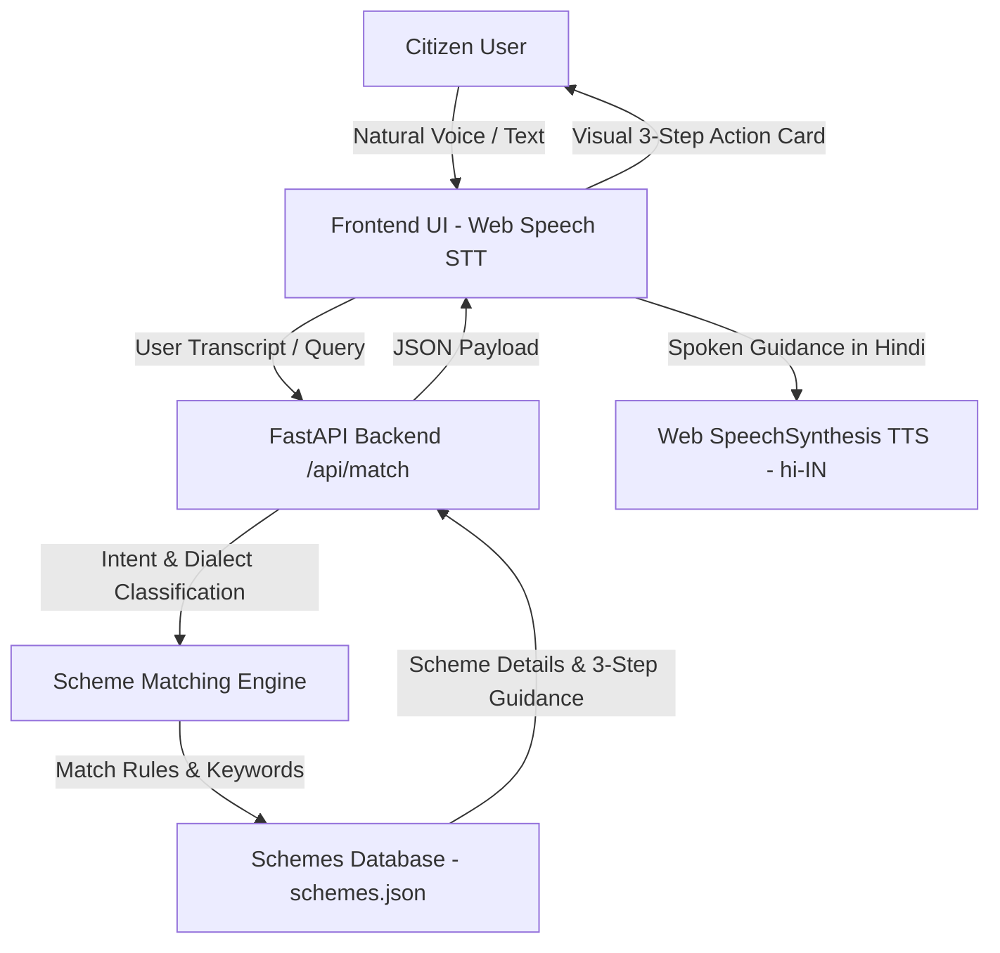

# VaaniAccess: Dialect-Adaptive Public Scheme Voice Navigator

> **Empowering every citizen to effortlessly discover, understand, and access government welfare schemes using everyday spoken Hindi.**

[](https://www.geeksforgeeks.org/)
[](https://github.com/shrijanshukla39/catalystHack-project)
[](https://fastapi.tiangolo.com)
[](https://www.python.org)
[](https://opensource.org/licenses/MIT)

---

## 📌 Problem Statement

India hosts hundreds of beneficial central and state welfare initiatives—ranging from agricultural income support and medical coverage to educational scholarships. However, millions of eligible citizens—particularly in rural and semi-urban communities—remain excluded from these entitlements due to:

- **Literacy & Digital Barriers:** Complex government portals require fluent reading skills and digital proficiency.
- **Bureaucratic Terminology:** Official scheme descriptions are dense with administrative jargon that everyday citizens find intimidating.
- **Form Navigation Overload:** Identifying the right scheme often requires navigating confusing category filters and multi-page forms.

Citizens need a human-centric, voice-driven interface where they can simply ask for help in natural, spoken Hindi and receive immediate, clear guidance.

---

## 💡 Solution Overview

**VaaniAccess** is an accessible, voice-first public scheme navigator designed for rapid, zero-barrier welfare discovery. Instead of navigating confusing web forms, a citizen simply taps the microphone and speaks in everyday conversational Hindi (e.g., *"Main kisan hoon"* or *"Main college student hoon"*).

The application:
1. **Listens & Transcribes:** Captures spoken Hindi in real time via the Web Speech API.
2. **Extracts Intent & Profile Clues:** Detects target beneficiary roles (farmers, students, senior citizens, women, healthcare).
3. **Matches Schemes:** Identifies eligible welfare programs with confidence scoring.
4. **Responds Spoken & Visual:** Delivers a clear, spoken 3-step action roadmap in simple Hindi alongside accessible visual cards.

---

## ✨ Key Features

- 🎙️ **Hindi Voice Input (Web Speech STT):** Real-time speech recognition tuned for Indian Hindi speech (`hi-IN`) and conversational inputs, with active audio waveform visualizer and acoustic chime feedback.
- 🗣️ **Dialect & Vernacular Intent Classification:**
  - Devanagari Hindi (*"मैं खेती करता हूँ"*, *"कॉलेज छात्र हूँ"*, *"मेरी उम्र 65 साल है"*)
  - Romanized Hinglish (*"Main kheti karta hoon"*, *"Main college student hoon"*, *"65 saal"*)
  * Regional Dialects (*"Hum kheti karat baani"*, *"Hamaar umar 65 saal ba"*)
- 🎯 **Scheme & Eligibility Matching Engine:**
  - **Farmers (किसान)**: PM-Kisan Samman Nidhi, PM Fasal Bima Yojana
  - **Students (छात्र)**: National Scholarship Portal (NSP Post-Matric), PM-YASASVI
  - **Senior Citizens (बुजुर्ग)**: Indira Gandhi National Old Age Pension (IGNOAPS), Atal Pension Yojana
  - **Women Welfare (महिला)**: Pradhan Mantri Matru Vandana Yojana (PMMVY), Sukanya Samriddhi
  - **Healthcare (स्वास्थ्य)**: Ayushman Bharat (PM-JAY)
  - **Housing (आवास)**: Pradhan Mantri Awas Yojana (PMAY)
- 🚀 **Simple Three-Step Guidance (FR-5):** Replaces bureaucratic clutter with a concise 3-step roadmap:
  1. *Documents Ready Karein* (दस्तावेज़ तैयार करें)
  2. *Portal Par Register Karein* (पोर्टल पर रजिस्टर करें)
  3. *Application Submit Karein* (आवेदन सबमिट करें)
- 🔊 **Hindi Voice Output (SpeechSynthesis TTS):** Natural speech synthesis that reads out scheme details and actionable advice in clear Hindi with pause, replay, and speed controls.
- ⌨️ **Text-Input Fallback & One-Tap Demo Chips:** On-screen input fallback and instant demo query chips for noisy public surroundings or devices without microphone access.
- 📋 **All Schemes Catalog Explorer:** Browse all schemes organized by beneficiary categories.

---

## 🏗️ Architecture



---

## 🛠️ Tech Stack

- **Backend:** FastAPI, Uvicorn, Pydantic (Python 3.10+)
- **Frontend & UI:** HTML5, Modern CSS3 (Glassmorphism, CSS Grid, Micro-animations), Vanilla JavaScript (ES6+)
- **Speech Recognition:** Web Speech API (`SpeechRecognition` / `webkitSpeechRecognition` configured for `hi-IN`)
- **Speech Synthesis:** Web Speech API (`window.speechSynthesis` with Hindi voice output)
- **Audio Feedback:** Web Audio API synthesizer for acoustic chime feedback
- **Data Layer:** Structured JSON welfare knowledge base mapping citizen personas to welfare programs

---

## 🚀 Installation & Local Setup

### Prerequisites
- Python 3.10 or higher
- A modern web browser (Google Chrome or Microsoft Edge recommended)
- A working microphone

### Quick Start

1. **Clone the repository:**
   ```bash
   git clone https://github.com/shrijanshukla39/catalystHack-project.git
   cd catalystHack-project
   ```

2. **Install dependencies:**
   ```bash
   pip install -r requirements.txt
   ```

3. **Run Application:**
   ```bash
   python run.py
   ```
   Open your browser at **`http://127.0.0.1:8000`**.

---

## 🧪 Running Tests

Run the automated test suite verifying all PRD user stories:
```bash
python -m unittest discover -s tests
```

---

## 🗣️ Example Voice Queries

| Persona | Example Spoken Query | Matched Welfare Scheme | Benefit Highlight |
| :--- | :--- | :--- | :--- |
| **Farmer** | *"Main kheti karta hoon"* / *"Hum kheti karat baani"* | **PM-Kisan Samman Nidhi** | ₹6,000 / वर्ष प्रत्यक्ष सहायता |
| **Student** | *"Main college student hoon"* / *"Padhai ke liye scholarship"* | **NSP Post-Matric Scholarship** | ₹10,000 - ₹50,000 / वर्ष वजीफा |
| **Senior Citizen** | *"Meri umar 65 saal hai"* / *"Buzurg pension"* | **IGNOAPS Senior Pension** | ₹1,000 - ₹3,000 / माह पेंशन |
| **Women** | *"Main mahila hoon mujhe madad chahiye"* | **PM Matru Vandana Yojana** | ₹5,000 - ₹6,000 नकद सहायता |
| **Healthcare** | *"Ayushman card ilaj"* | **Ayushman Bharat (PM-JAY)** | ₹5,00,000 / वर्ष मुफ्त इलाज |

---

## 📂 Project Structure

```text
catalystHack-project/
├── backend/
│   ├── __init__.py
│   └── engine.py             # Intent & dialect matching engine
├── data/
│   └── schemes.json          # Curated welfare schemes database
├── static/
│   ├── assets/
│   │   └── vaaniaccess_banner.jpg # Branding banner
│   ├── app.js                # Web Speech STT/TTS & UI controller
│   ├── index.html            # Accessible voice-first interface
│   └── style.css             # Design system with glowing animations
├── tests/
│   └── test_engine.py        # PRD test suite (100% pass)
├── main.py                   # FastAPI application & REST endpoints
├── run.py                    # Server launcher
├── requirements.txt          # Python dependencies
└── README.md
```

---

## 👥 Team

Built with ❤️ for the 4-Hour Software Hackathon:

| Contributor | GitHub |
| :--- | :--- |
| **Shrijan Shukla** | [@shrijanshukla39](https://github.com/shrijanshukla39) |

---

## 🔮 Future Improvements

- 🌐 **Expanded Regional Dialects:** Extend speech models to support dialects and regional languages (Bhojpuri, Maithili, Awadhi, Bengali, Tamil, Marathi, etc.).
- 📡 **Live Scheme API Integration:** Connect to official APIs (such as data.gov.in and MyScheme) for live updates on application deadlines and budget allocations.
- 📄 **Downloadable Document Checklists:** One-click generation of visual PDF document checklists that citizens can carry to their nearest CSC (Common Service Centre).
- 🤖 **Interactive Multi-Turn Eligibility:** Conversational follow-up questions to pinpoint exact subsidy amounts based on land size, annual household income, and category.
- 📴 **Progressive Web App (PWA):** Enable offline-first caching for regions with unstable rural internet connectivity.

---

## 🇮🇳 Hackathon Value Proposition
**VaaniAccess transforms government schemes from complex forms into simple conversations, enabling true digital inclusion for every citizen.**

---

## 📄 License
This project is licensed under the **MIT License** - see the [LICENSE](LICENSE) file for details.
