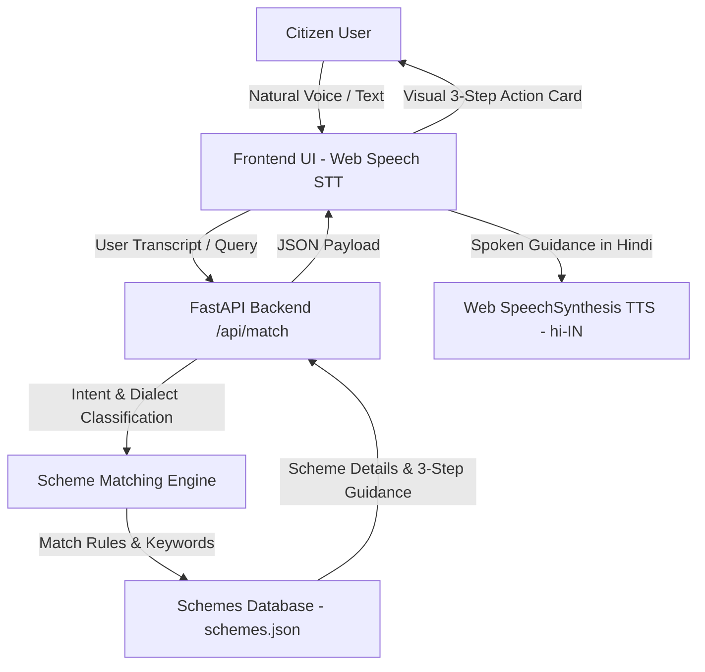

<<<<<<< HEAD
# वाणी एक्सेस (VaaniAccess)
### Dialect-Adaptive Public Scheme Voice Navigator

[](https://fastapi.tiangolo.com)
[](https://www.python.org)
[](https://developer.mozilla.org/en-US/docs/Web/API/Web_Speech_API)
[](LICENSE)

---

## 🎯 Problem Statement
Millions of Indian citizens struggle to access government welfare schemes because information is available in complex bureaucratic language, forms are difficult to understand, and many users have limited literacy or digital skills.

**VaaniAccess** provides a simple, voice-based interface that understands natural speech in Hindi, Hinglish, and local dialects (Bhojpuri/Awadhi), identifies user eligibility, and provides clear **3-step actionable guidance** with Hindi voice readout.

---

## 🌟 Key Features

* 🎙️ **Voice-First Input (Web Speech STT)**: Click-to-talk microphone with real-time waveform audio visualizer and acoustic chime feedback.
* 🗣️ **Dialect & Vernacular Intent Classification**:
  * Devanagari Hindi (*"मैं खेती करता हूँ"*, *"कॉलेज छात्र हूँ"*, *"मेरी उम्र 65 साल है"*)
  * Romanized Hinglish (*"Main kheti karta hoon"*, *"Main college student hoon"*, *"65 saal"*)
  * Regional Dialects (*"Hum kheti karat baani"*, *"Hamaar umar 65 saal ba"*)
* 🎯 **Welfare Scheme Matching Engine**:
  * **Farmers**: PM-Kisan Samman Nidhi, PM Fasal Bima Yojana
  * **Students**: National Scholarship Portal (NSP), PM-YASASVI Scholarship
  * **Senior Citizens**: Indira Gandhi National Old Age Pension (IGNOAPS), Atal Pension Yojana
  * **Women Welfare**: Pradhan Mantri Matru Vandana Yojana (PMMVY), Sukanya Samriddhi
  * **Healthcare**: Ayushman Bharat (PM-JAY)
  * **Housing**: Pradhan Mantri Awas Yojana (PMAY)
* 🚀 **3-Step Action Pathway (FR-5)**:
  1. *Documents Ready Karein* (दस्तावेज़ तैयार करें)
  2. *Portal Par Register Karein* (पोर्टल पर रजिस्टर करें)
  3. *Application Submit Karein* (आवेदन सबमिट करें)
* 🔊 **Hindi Voice Output (SpeechSynthesis TTS)**: Automatic spoken response in Hindi (`hi-IN`) with replay, stop, and speed toggles (Normal vs Slow for elderly citizens).
* ✍️ **Fallback Text Input & Quick Demo Chips**: Instant one-tap evaluation chips for noisy environments.
* 📋 **All Schemes Catalog Explorer**: Browse all schemes organized by beneficiary categories.

---

## 🏗️ Architecture



---

## ⚡ Quick Start

### 1. Prerequisites
- Python 3.10 or higher

### 2. Installation
Clone the repository and install dependencies:
```bash
git clone https://github.com/shrijanshukla39/catalystHack-project.git
cd catalystHack-project
pip install -r requirements.txt
```

### 3. Run Application
```bash
python run.py
```
Open your browser at **`http://127.0.0.1:8000`**.

---

## 🧪 Running Tests

Run the automated test suite verifying all PRD user stories:
```bash
python -m unittest discover -s tests
```

---

## 📁 Project Structure

```text
catalystHack-project/
├── backend/
│   ├── __init__.py
│   └── engine.py             # Intent & dialect matching engine
├── data/
│   └── schemes.json          # Curated welfare schemes database
├── static/
│   ├── assets/
│   │   └── vaaniaccess_banner.jpg # Branding banner
│   ├── app.js                # Web Speech STT/TTS & UI controller
│   ├── index.html            # Accessible voice-first interface
│   └── style.css             # Design system with glowing animations
├── tests/
│   └── test_engine.py        # PRD test suite (100% pass)
├── main.py                   # FastAPI application & REST endpoints
├── run.py                    # Server launcher
├── requirements.txt          # Python dependencies
└── README.md
=======
# VaaniAccess: Dialect-Adaptive Public Scheme Voice Navigator

> **Empowering every citizen to effortlessly discover, understand, and access government welfare schemes using everyday spoken Hindi.**

[](https://www.geeksforgeeks.org/)
[](https://github.com/shrijanshukla39/catalystHack-project)
[](https://opensource.org/licenses/MIT)

---

## 📌 Problem Statement

India hosts hundreds of beneficial central and state welfare initiatives—ranging from agricultural income support and medical coverage to educational scholarships. However, millions of eligible citizens—particularly in rural and semi-urban communities—remain excluded from these entitlements due to:

- **Literacy & Digital Barriers:** Complex government portals require fluent reading skills and digital proficiency.
- **Bureaucratic Terminology:** Official scheme descriptions are dense with administrative jargon that everyday citizens find intimidating.
- **Form Navigation Overload:** Identifying the right scheme often requires navigating confusing category filters and multi-page forms.

Citizens need a human-centric, voice-driven interface where they can simply ask for help in natural, spoken Hindi and receive immediate, clear guidance.

---

## 💡 Solution Overview

**VaaniAccess** is an accessible, voice-first public scheme navigator designed for rapid, zero-barrier welfare discovery. Instead of navigating confusing web forms, a citizen simply taps the microphone and speaks in everyday conversational Hindi (e.g., *"Main kisan hoon"* or *"Main college student hoon"*).

The application:
1. **Listens & Transcribes:** Captures spoken Hindi in real time.
2. **Extracts Intent & Profile Clues:** Detects target beneficiary roles (farmers, students, senior citizens, artisans).
3. **Matches Schemes:** Identifies eligible welfare programs.
4. **Responds Spoken & Visual:** Delivers a clear, spoken 3-step action roadmap in simple Hindi alongside accessible visual cards.

Built as a lightweight, working hackathon prototype, VaaniAccess eliminates cognitive friction and brings digital welfare access directly to the citizen's voice.

---

## ✨ Key Features

- 🎙️ **Hindi Voice Input:** Real-time speech recognition tuned for Indian Hindi speech (`hi-IN`) using the browser's native speech engine.
- 🎯 **Scheme & Eligibility Matching:** Maps colloquial user self-identifications (e.g., *"kisan"*, *"student"*, *"chhota vyapari"*) directly to relevant welfare programs.
- 🔊 **Hindi Voice Output:** Natural speech synthesis that reads out scheme details and actionable advice in clear Hindi.
- 📋 **Simple Three-Step Guidance:** Replaces bureaucratic clutter with a concise, three-step action checklist (eligibility criteria, required documents, and where to apply).
- ⌨️ **Text-Input Fallback:** On-screen input fallback for noisy public surroundings, network constraints, or devices without microphone access.

---

## 🔄 How It Works

```
┌─────────────────┐       ┌──────────────────────┐       ┌────────────────────────┐       ┌────────────────────────┐
│   Voice Query   │ ───►  │  Speech Recognition  │ ───►  │  Intent & Eligibility  │ ───►  │     Scheme Match       │
│ ("Main kisan    │       │     (Web Speech API) │       │       Classifier       │       │    Knowledge Base      │
│     hoon")      │       │    Converts to text  │       │  Extracts user persona │       │ (e.g., PM-Kisan / KCC) │
└─────────────────┘       └──────────────────────┘       └────────────────────────┘       └───────────┬────────────┘
                                                                                                      │
                                                                                                      ▼
                                                         ┌─────────────────────────────────────────────────────────┐
                                                         │                 Actionable Guidance                     │
                                                         │  • Hindi Voice Output (Speech Synthesis)                │
                                                         │  • Clear 3-Step Visual Card & Application Link          │
                                                         └─────────────────────────────────────────────────────────┘
```

1. **Voice Capture:** The user taps the microphone button and speaks their situation or query in natural Hindi.
2. **Speech Recognition:** Spoken audio is processed in real time via the Web Speech API and transcribed into text.
3. **Persona & Intent Parsing:** Keyword and semantic heuristics identify the user's demographic group (e.g., agriculture, education, healthcare).
4. **Scheme Matching:** The system matches the detected intent with verified scheme criteria stored in the scheme registry.
5. **Spoken & Visual Guidance:** The application displays the scheme details and immediately reads out three concrete steps in spoken Hindi.

---

## 🛠️ Tech Stack

VaaniAccess is intentionally engineered to be lightweight, zero-dependency, and client-runnable for maximum accessibility and immediate performance:

- **Frontend & UI:** HTML5, CSS3, Vanilla JavaScript (ES6+)
- **Speech Recognition:** Web Speech API (`SpeechRecognition` / `webkitSpeechRecognition` configured for `hi-IN`)
- **Speech Synthesis:** Web Speech API (`window.speechSynthesis` with Hindi voice output)
- **Data Layer:** Client-side JSON / JavaScript scheme knowledge base mapping citizen personas to welfare programs

*(Zero external paid API keys or heavyweight servers required for the prototype, ensuring full privacy and instant execution).*

---

## 🚀 Installation & Local Setup

Because the project runs natively in modern web browsers, setup takes less than two minutes:

### Prerequisites
- A modern web browser with Web Speech API support (**Google Chrome** or **Microsoft Edge** recommended).
- A working microphone.

### Quick Start

1. **Clone the repository:**
   ```bash
   git clone https://github.com/shrijanshukla39/catalystHack-project.git
   cd catalystHack-project
   ```

2. **Open the application:**
   - **Option A (Direct):** Double-click `index.html` to open it in your browser.
   - **Option B (Local Static Server):**
     ```bash
     # Using Python 3
     python -m http.server 8000
     ```
     Then open `http://localhost:8000` in Google Chrome or Microsoft Edge.

3. **Grant Permissions:** Allow microphone access when prompted by the browser.

---

## 🗣️ Usage Instructions

### Example Voice Queries

Try speaking any of the following natural Hindi phrases into the microphone:

| Persona | Example Spoken Hindi Query | Matched Welfare Scheme |
| :--- | :--- | :--- |
| **Farmer** | *"Main kisan hoon"* / *"Kheti ke liye sarkari yojana bataiye"* | **PM-Kisan Samman Nidhi** |
| **Student** | *"Main college student hoon"* / *"Mujhe scholarship chahiye"* | **Post-Matric Scholarship / PM-USP** |
| **Healthcare** | *"Mujhe hospital aur ilaj ke liye madad chahiye"* | **Ayushman Bharat (PM-JAY)** |
| **Small Business** | *"Mera chhota dukan hai, karz chahiye"* | **PM SVANidhi Scheme** |

### Step-by-Step Flow:
1. Tap the **"Mic"** button.
2. Speak your query in Hindi when the indicator turns active.
3. View the matched scheme card on your screen.
4. Listen to the 3-step spoken guidance explaining how and where to apply.
5. In noisy environments, switch to the **Text Input** field, type your query, and press Search.

---

## 📂 Project Structure

```text
catalystHack-project/
├── index.html          # Core user interface and layout
├── style.css           # Styling, responsive design, and accessible UI components
├── app.js              # Speech recognition, intent matching logic & voice synthesis
├── data/
│   └── schemes.json    # Scheme repository with eligibility clues & 3-step guides
└── README.md           # Project documentation and hackathon submission overview
>>>>>>> 73f1d9f31f96c78eeeae11e2ad5f8bf98893edf1
```

---

<<<<<<< HEAD
## 🇮🇳 Hackathon Value Proposition
**VaaniAccess transforms government schemes from complex forms into simple conversations, enabling true digital inclusion for every citizen.**
=======
## 📸 Screenshots & Demo

<!-- Add your demo video link below (e.g., YouTube, Loom, or Google Drive) -->
[](#)

<!-- Placeholders: Replace with actual screenshot links or file paths when available -->
| Voice Query Interface | Scheme Match & 3-Step Guidance |
| :---: | :---: |
| <!-- Add screenshot of voice listening screen here -->  | <!-- Add screenshot of scheme recommendation screen here -->  |

---

## 👥 Team

Built with ❤️ for the 4-Hour Software Hackathon by:

| Contributor | Role | GitHub |
| :--- | :--- | :--- |
| **[Contributor 1 Name]** | Voice AI & Integration Lead | [@username](https://github.com/shrijanshukla39) |
| **[Contributor 2 Name]** | Scheme Matching & Logic Engine | [@username](https://github.com/) |
| **[Contributor 3 Name]** | Frontend & Accessibility Design | [@username](https://github.com/) |
| **[Contributor 4 Name]** | Research & Scheme Data Architecture | [@username](https://github.com/) |

---

## 🔮 Future Improvements

- 🌐 **Expanded Regional Dialects:** Extend speech models to support dialects and regional languages (Bhojpuri, Maithili, Awadhi, Bengali, Tamil, Marathi, etc.).
- 📡 **Live Scheme API Integration:** Connect to official APIs (such as data.gov.in and MyScheme) for live updates on application deadlines and budget allocations.
- 📄 **Downloadable Document Checklists:** One-click generation of visual PDF document checklists that citizens can carry to their nearest CSC (Common Service Centre).
- 🤖 **Interactive Multi-Turn Eligibility:** Implement conversational follow-up questions to pinpoint exact subsidy amounts based on land size, annual household income, and category.
- 📴 **Progressive Web App (PWA):** Enable offline-first caching for regions with unstable rural internet connectivity.

---

## 🏆 Acknowledgements

- **Career Catalyst Club × GeeksforGeeks** for organizing the 4-Hour Software Hackathon and presenting the problem statement: *[CC-GFG-06] VaaniAccess: Dialect-Adaptive Public Scheme Voice Navigator*.
- Government open data initiatives for scheme documentation and public welfare structures.

---

## 📄 License

This project is licensed under the **MIT License** - see the [LICENSE](LICENSE) file for details.
>>>>>>> 73f1d9f31f96c78eeeae11e2ad5f8bf98893edf1
