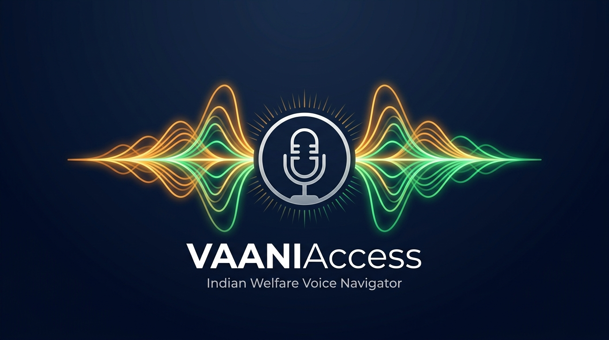
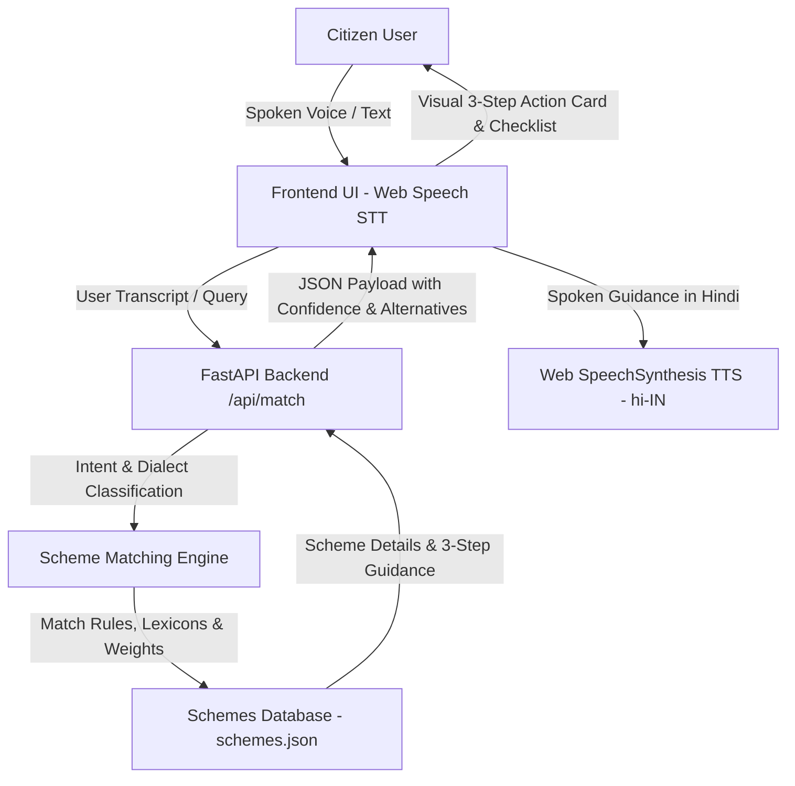

# वाणी एक्सेस (VaaniAccess)
### Dialect-Adaptive Public Scheme Voice Navigator..

<div align="center">



**Empowering every citizen to effortlessly discover,, understand, and access government welfare schemes using everyday spoken Hindi.**

[](https://www.geeksforgeeks.org/)
[](https://github.com/shrijanshukla39/catalystHack-project)
[](https://fastapi.tiangolo.com)
[](https://www.python.org)
[](https://developer.mozilla.org/en-US/docs/Web/API/Web_Speech_API)
[](#-running-tests)
[](LICENSE)

</div>

---

## 📌 Problem Statement

India hosts hundreds of central and state welfare initiatives—ranging from agricultural income support and healthcare coverage to educational scholarships and old-age pensions. However, millions of eligible citizens—particularly in rural and semi-urban communities—remain excluded from these entitlements due to:

- **Literacy & Digital Barriers:** Complex government portals require high literacy and digital proficiency.
- **Bureaucratic Terminology:** Official scheme documents are saturated with administrative jargon that citizens find intimidating.
- **Navigation Overload:** Discovering the correct scheme often requires navigating confusing category filters and dense multi-page forms.

Citizens need a human-centric, voice-driven interface where they can simply ask for help in natural, everyday spoken Hindi and receive immediate, actionable guidance.

---

## 💡 Solution Overview

**VaaniAccess** is an accessible, voice-first public scheme navigator designed for rapid, zero-barrier welfare discovery. Instead of filling out multi-page bureaucratic forms, a citizen simply taps the microphone and speaks naturally in their everyday dialect (e.g., *"Main kheti karta hoon"* or *"Hum kheti karat baani"*).

The platform:
1. **Captures Voice:** Transcribes spoken Hindi in real time via the Web Speech API with live waveform visualization and acoustic chime feedback.
2. **Classifies Vernacular & Intent:** Intelligently parses Devanagari Hindi, Romanized Hinglish, and regional dialects (Bhojpuri/Awadhi) to identify beneficiary personas.
3. **Matches Schemes:** Queries a curated welfare database with confidence scoring and alternative scheme recommendations.
4. **Delivers Spoken & Visual 3-Step Guidance (FR-5):** Provides a clean, spoken 3-step action roadmap alongside required document checklists and official application portal links.

---

## ✨ Key Features

- 🎙️ **Voice-First Input (Web Speech STT):** Real-time speech recognition tuned for Indian Hindi speech (`hi-IN`) and conversational inputs, paired with an active audio waveform visualizer and acoustic chime feedback.
- 🗣️ **Dialect & Vernacular Intent Classification:**
  - **Devanagari Hindi:** *"मैं खेती करता हूँ"*, *"मैं कॉलेज छात्र हूँ"*, *"मेरी उम्र 65 साल है"*
  - **Romanized Hinglish:** *"Main kheti karta hoon"*, *"Main college student hoon"*, *"Meri umar 65 saal hai"*
  - **Regional Dialects:** *"Hum kheti karat baani"*, *"Hamaar umar 65 saal ba"* (Bhojpuri / Awadhi)
  - **Age Extraction:** Automatically detects senior citizen age thresholds (`60+` years).
- 🎯 **Scheme & Eligibility Matching Engine:**
  - **Farmers (किसान):** PM-Kisan Samman Nidhi, PM Fasal Bima Yojana
  - **Students (छात्र):** National Scholarship Portal (NSP Post-Matric), PM-YASASVI
  - **Senior Citizens (बुजुर्ग):** Indira Gandhi National Old Age Pension (IGNOAPS), Atal Pension Yojana
  - **Women Welfare (महिला):** Pradhan Mantri Matru Vandana Yojana (PMMVY), Sukanya Samriddhi
  - **Healthcare (स्वास्थ्य):** Ayushman Bharat (PM-JAY)
  - **Housing (आवास):** Pradhan Mantri Awas Yojana (PMAY)
- 🚀 **FR-5 Compliant 3-Step Action Pathway:** Replaces bureaucratic confusion with a concise, actionable 3-step roadmap:
  1. *Documents Ready Karein* (दस्तावेज़ तैयार करें)
  2. *Portal Par Register Karein* (पोर्टल पर रजिस्टर करें)
  3. *Application Submit Karein* (आवेदन सबमिट करें)
- 🔊 **Hindi Voice Output (SpeechSynthesis TTS):** Reads out scheme benefits and step-by-step guidance in clear Hindi with pause, replay, and speed toggles (**Normal** vs **Slow** for elderly users).
- ⌨️ **Text-Input Fallback & One-Tap Demo Chips:** Quick-select chips (Farmer, Student, Senior Citizen, Women, Healthcare) for instant demonstrations or noisy public surroundings.
- 📋 **All Schemes Catalog Explorer:** Searchable modal browser displaying all welfare schemes organized by beneficiary category.
- ⚡ **Full-Stack REST API:** High-performance FastAPI backend with Swagger UI docs at `/docs`.

---

## 🏗️ Architecture



---

## 🛠️ Tech Stack

- **Backend:** FastAPI, Uvicorn, Pydantic (Python 3.10+)
- **Frontend & UI:** HTML5, Vanilla CSS3 (Glassmorphism, CSS Grid, Micro-animations), Vanilla JavaScript (ES6+)
- **Speech Recognition:** Web Speech API (`SpeechRecognition` / `webkitSpeechRecognition` configured for `hi-IN`)
- **Speech Synthesis:** Web Speech API (`window.speechSynthesis` with Hindi voice output & speed control)
- **Audio Feedback:** Web Audio API synthesizer generating responsive audio cues and chime feedback
- **Data Layer:** Structured JSON welfare knowledge base mapping citizen personas to welfare programs

---

## 📡 REST API Reference

The FastAPI backend provides clean, documented REST endpoints accessible at `http://127.0.0.1:8000`:

| Method | Endpoint | Description |
| :--- | :--- | :--- |
| `GET` | `/api/health` | Service health status, scheme counts, and category statistics |
| `POST` | `/api/match` | Primary intent & scheme matching endpoint (`query`, optional `dialect`) |
| `GET` | `/api/schemes` | Returns complete list of all welfare schemes & categories |
| `GET` | `/api/schemes/{id}` | Returns detailed data & 3-step guidance for a specific scheme |
| `GET` | `/api/categories` | Returns all citizen beneficiary categories |
| `GET` | `/docs` | Interactive Swagger API documentation & testing console |

---

## 🚀 Installation & Local Setup

### Prerequisites
- Python 3.10 or higher
- A modern web browser (Google Chrome or Microsoft Edge recommended)
- A working microphone

### Quick Start

1. **Clone the repository:**
   ```bash
   git clone https://github.com/shrijanshukla39/catalystHack-project.git
   cd catalystHack-project
   ```

2. **Install dependencies:**
   ```bash
   pip install -r requirements.txt
   ```

3. **Run Application:**
   ```bash
   python run.py
   ```
   Or launch directly with Uvicorn:
   ```bash
   uvicorn main:app --reload --host 127.0.0.1 --port 8000
   ```

4. **Access the application:**
   - Web App: **`http://127.0.0.1:8000`**
   - API Docs: **`http://127.0.0.1:8000/docs`**

---

## 🧪 Running Tests

Run the automated test suite verifying all PRD user stories, dialect matching, and FR-5 three-step instruction compliance:
```bash
python -m unittest discover -s tests
```

---

## 🗣️ Example Voice Queries

| Persona | Example Spoken Query | Dialect / Mode | Matched Welfare Scheme | Benefit Highlight |
| :--- | :--- | :--- | :--- | :--- |
| **Farmer** | *"Main kheti karta hoon"* | Hinglish | **PM-Kisan Samman Nidhi** | ₹6,000 / वर्ष प्रत्यक्ष सहायता |
| **Farmer** | *"Hum kheti karat baani"* | Bhojpuri | **PM-Kisan Samman Nidhi** | ₹6,000 / वर्ष प्रत्यक्ष सहायता |
| **Farmer** | *"Fasal ka bima karana hai"* | Hinglish | **PM Fasal Bima Yojana** | फसल नुकसान पर वित्तीय सुरक्षा |
| **Student** | *"Main college student hoon"* | Hinglish | **NSP Post-Matric Scholarship** | ₹10,000 - ₹50,000 / वर्ष वजीफा |
| **Student** | *"मैं कॉलेज छात्र हूँ"* | Devanagari | **NSP Post-Matric Scholarship** | ₹10,000 - ₹50,000 / वर्ष वजीफा |
| **Senior Citizen** | *"Meri umar 65 saal hai"* | Hinglish | **IGNOAPS Senior Pension** | ₹1,000 - ₹3,000 / माह पेंशन |
| **Senior Citizen** | *"Hamaar umar 65 saal ba"* | Bhojpuri | **IGNOAPS Senior Pension** | ₹1,000 - ₹3,000 / माह पेंशन |
| **Women** | *"Main mahila hoon mujhe madad chahiye"* | Hinglish | **PM Matru Vandana Yojana** | ₹5,000 - ₹6,000 नकद सहायता |
| **Healthcare** | *"Ayushman card ilaj"* | Hinglish | **Ayushman Bharat (PM-JAY)** | ₹5,00,000 / वर्ष मुफ्त इलाज |
| **Housing** | *"Ghar banane ke liye sarkari madad"* | Hinglish | **PM Awas Yojana (PMAY)** | पक्के मकान हेतु ₹1.20 - ₹2.50 लाख |

---

## 📱 User Flow

1. **Tap the Microphone:** Click the microphone button to start listening.
2. **Speak Naturally:** Speak your query in Hindi, Hinglish, or regional dialect (e.g., Bhojpuri).
3. **View Matched Scheme:** The system identifies your beneficiary profile with confidence scoring and displays the top matching scheme alongside relevant alternatives.
4. **Listen to Guidance:** Natural Hindi voice automatically reads out the 3-step action roadmap.
5. **Check Documents & Apply:** Review the required documents checklist and click the direct link to the official government portal.

---

## 📂 Project Structure

```text
catalystHack-project/
├── backend/
│   ├── __init__.py
│   └── engine.py             # Intent, dialect matching & scoring engine
├── data/
│   └── schemes.json          # Curated welfare schemes database (FR-5 roadmaps)
├── static/
│   ├── assets/
│   │   └── vaaniaccess_banner.jpg # Project branding banner
│   ├── app.js                # Web Speech STT/TTS & UI controller
│   ├── index.html            # Accessible voice-first interface
│   └── style.css             # Glassmorphism design system with glowing animations
├── tests/
│   └── test_engine.py        # PRD test suite (100% pass)
├── main.py                   # FastAPI application & REST endpoints
├── run.py                    # Server launcher
├── requirements.txt          # Python dependencies
└── README.md                 # Comprehensive project documentation
```

---

## 👥 Team

Built with ❤️ for the **Career Catalyst Club × GeeksforGeeks 4-Hour Software Hackathon**:

| Contributor | Role | GitHub |
| :--- | :--- | :--- |
| **Shrijan Shukla** | Project Architecture, Research & Documentation | [@shrijanshukla39](https://github.com/shrijanshukla39) |
| **Narendra Mishra** | Voice AI, FastAPI Engine & Full-Stack Implementation | [@narendramishra4556](https://github.com/narendramishra4556) |

---

## 🔮 Future Improvements

- 🌐 **Expanded Regional Dialects:** Extend speech models to support additional dialects and regional languages (Maithili, Awadhi, Bengali, Tamil, Telugu, Marathi).
- 📡 **Live Scheme API Integration:** Connect to official APIs (such as data.gov.in and MyScheme) for real-time application deadlines and state-level quotas.
- 📄 **Downloadable Document Checklists:** One-click generation of visual PDF checklists for citizens to take to their nearest Common Service Centre (CSC).
- 🤖 **Interactive Multi-Turn Eligibility:** Conversational follow-up questions to pinpoint exact subsidy amounts based on land size, annual household income, and category.
- 📴 **Progressive Web App (PWA):** Enable offline-first caching for areas with intermittent rural internet connectivity.

---

## 🏆 Acknowledgements

- **Career Catalyst Club × GeeksforGeeks** for organizing the 4-Hour Software Hackathon and presenting the problem statement: *[CC-GFG-06] VaaniAccess: Dialect-Adaptive Public Scheme Voice Navigator*.
- **Government of India open data initiatives** (data.gov.in & myscheme.gov.in) for scheme documentation and public welfare structures.

---

## 📄 License

This project is licensed under the **MIT License** - see the [LICENSE](LICENSE) file for details.
