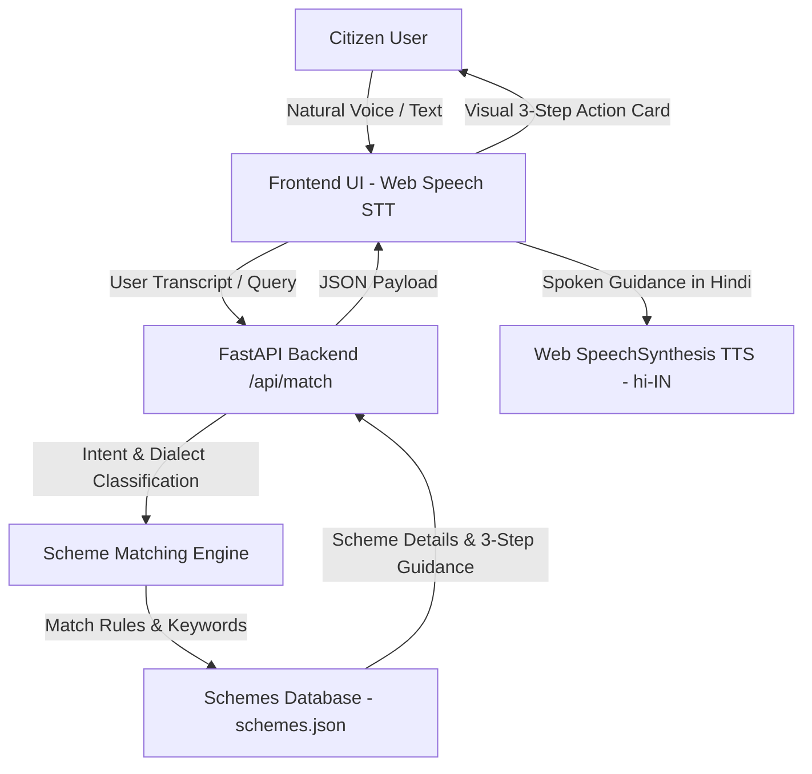

# वाणी एक्सेस (VaaniAccess)
### Dialect-Adaptive Public Scheme Voice Navigator

[](https://fastapi.tiangolo.com)
[](https://www.python.org)
[](https://developer.mozilla.org/en-US/docs/Web/API/Web_Speech_API)
[](LICENSE)

---

## 🎯 Problem Statement
Millions of Indian citizens struggle to access government welfare schemes because information is available in complex bureaucratic language, forms are difficult to understand, and many users have limited literacy or digital skills.

**VaaniAccess** provides a simple, voice-based interface that understands natural speech in Hindi, Hinglish, and local dialects (Bhojpuri/Awadhi), identifies user eligibility, and provides clear **3-step actionable guidance** with Hindi voice readout.

---

## 🌟 Key Features

* 🎙️ **Voice-First Input (Web Speech STT)**: Click-to-talk microphone with real-time waveform audio visualizer and acoustic chime feedback.
* 🗣️ **Dialect & Vernacular Intent Classification**:
  * Devanagari Hindi (*"मैं खेती करता हूँ"*, *"कॉलेज छात्र हूँ"*, *"मेरी उम्र 65 साल है"*)
  * Romanized Hinglish (*"Main kheti karta hoon"*, *"Main college student hoon"*, *"65 saal"*)
  * Regional Dialects (*"Hum kheti karat baani"*, *"Hamaar umar 65 saal ba"*)
* 🎯 **Welfare Scheme Matching Engine**:
  * **Farmers**: PM-Kisan Samman Nidhi, PM Fasal Bima Yojana
  * **Students**: National Scholarship Portal (NSP), PM-YASASVI Scholarship
  * **Senior Citizens**: Indira Gandhi National Old Age Pension (IGNOAPS), Atal Pension Yojana
  * **Women Welfare**: Pradhan Mantri Matru Vandana Yojana (PMMVY), Sukanya Samriddhi
  * **Healthcare**: Ayushman Bharat (PM-JAY)
  * **Housing**: Pradhan Mantri Awas Yojana (PMAY)
* 🚀 **3-Step Action Pathway (FR-5)**:
  1. *Documents Ready Karein* (दस्तावेज़ तैयार करें)
  2. *Portal Par Register Karein* (पोर्टल पर रजिस्टर करें)
  3. *Application Submit Karein* (आवेदन सबमिट करें)
* 🔊 **Hindi Voice Output (SpeechSynthesis TTS)**: Automatic spoken response in Hindi (`hi-IN`) with replay, stop, and speed toggles (Normal vs Slow for elderly citizens).
* ✍️ **Fallback Text Input & Quick Demo Chips**: Instant one-tap evaluation chips for noisy environments.
* 📋 **All Schemes Catalog Explorer**: Browse all schemes organized by beneficiary categories.

---

## 🏗️ Architecture



---

## ⚡ Quick Start

### 1. Prerequisites
- Python 3.10 or higher

### 2. Installation
Clone the repository and install dependencies:
```bash
git clone https://github.com/shrijanshukla39/catalystHack-project.git
cd catalystHack-project
pip install -r requirements.txt
```

### 3. Run Application
```bash
python run.py
```
Open your browser at **`http://127.0.0.1:8000`**.

---

## 🧪 Running Tests

Run the automated test suite verifying all PRD user stories:
```bash
python -m unittest discover -s tests
```

---

## 📁 Project Structure

```text
catalystHack-project/
├── backend/
│   ├── __init__.py
│   └── engine.py             # Intent & dialect matching engine
├── data/
│   └── schemes.json          # Curated welfare schemes database
├── static/
│   ├── assets/
│   │   └── vaaniaccess_banner.jpg # Branding banner
│   ├── app.js                # Web Speech STT/TTS & UI controller
│   ├── index.html            # Accessible voice-first interface
│   └── style.css             # Design system with glowing animations
├── tests/
│   └── test_engine.py        # PRD test suite (100% pass)
├── main.py                   # FastAPI application & REST endpoints
├── run.py                    # Server launcher
├── requirements.txt          # Python dependencies
└── README.md
```

---

## 🇮🇳 Hackathon Value Proposition
**VaaniAccess transforms government schemes from complex forms into simple conversations, enabling true digital inclusion for every citizen.**
